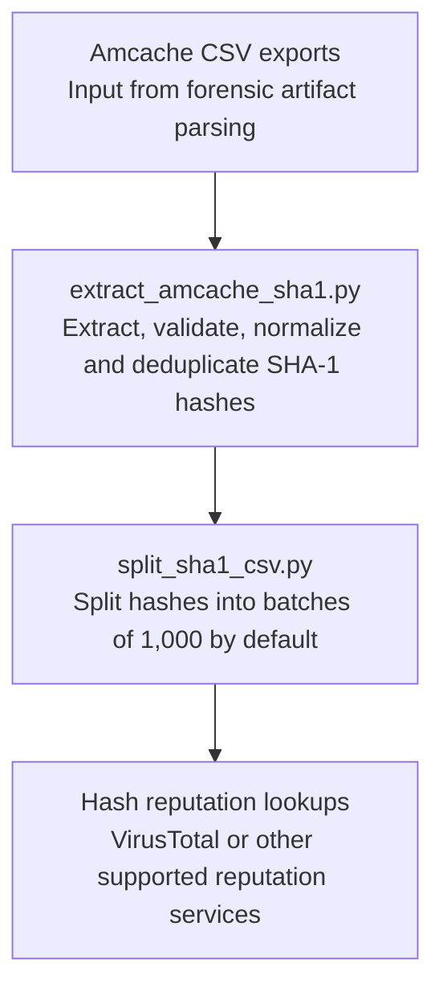

# Amcache SHA-1 Scripts

Two lightweight, standard-library-only Python utilities for extracting **unique SHA-1 hashes** from Windows Amcache parser CSV exports and splitting them into manageable batches for hash-reputation investigation.

These scripts prepare hash lists; they **do not upload files, send data to VirusTotal, query APIs, or identify malware automatically**.

## Investigation workflow



The diagram follows the two scripts' workflow. **Batch compatibility varies by reputation provider**, account tier, API, and submission interface; 1,000 hashes is a convenient local default, not a guaranteed VirusTotal upload limit.

## Requirements

- Python 3 with the `csv`, `re`, `sys`, and `pathlib` standard-library modules.
- CSV exports from an Amcache forensic parser containing one or more column headers with `sha1` in their name.

No additional packages are required.

## Quick start

Clone the repository:

```bash
git clone https://github.com/peli-rufus/amcache-sha1-scripts.git
cd amcache-sha1-scripts
```

**Step 1 — Extract hashes from all CSVs in a directory (recursively):**

```bash
python extract_amcache_sha1.py /cases/HOST01/Amcache amcache_sha1.csv
```

This script:
- Finds `*.csv` files recursively under the specified directory.
- Selects columns whose headers contain `sha1`, case-insensitively.
- Removes a leading `0000` from 44-character Amcache-prefixed hash values.
- Accepts valid 40-character hexadecimal SHA-1 hashes, converts them to lowercase, deduplicates them, and sorts the output.
- Writes a single-column CSV with header `sha1`.

If no output path is supplied, the default is `amcache_sha1.csv` in the current working directory.

**Step 2 — Split that CSV into batches:**

```bash
python split_sha1_csv.py amcache_sha1.csv chunks 1000
```

Output filenames follow the pattern:

```text
chunks/
  amcache_sha1_part001.csv
  amcache_sha1_part002.csv
  amcache_sha1_part003.csv
  ...
```

The final batch may contain fewer than 1,000 hashes. The default chunk size is **1,000**, and the default output directory is the input CSV's parent directory.

For smaller batches:

```bash
python split_sha1_csv.py amcache_sha1.csv chunks 500
```

The splitter copies the input CSV's header and first-column values. It assumes the source is a single-column SHA-1 CSV; it does not validate hashes or perform additional deduplication.

## Real-world DFIR use cases

### 1. Ransomware intrusion triage

Following a ransomware incident, extract SHA-1 hashes from acquired Amcache CSV exports to create a list of binaries recorded in the affected environment. Batch-check their reputation, prioritize unusual or flagged files, and pivot back to the original Amcache entries for paths and contextual evidence.

**Investigative question:** Which recorded binaries warrant deeper analysis for possible initial access tooling, lateral movement, or ransomware deployment?

### 2. Potential malicious tool or payload discovery

During an investigation involving suspicious PowerShell activity, remote access tools, or unexpected executables, use hash lookups to identify known malware or tools of interest among Amcache-derived file hashes. Then verify each finding against file paths, timestamps, execution evidence, and other artifacts.

**Investigative question:** Are any binaries documented by Amcache associated with a known suspicious tool family or malware sample?

### 3. Multi-host enterprise compromise assessment

Run the extraction workflow for each collected host and compare outputs to identify recurring hashes, including hashes observed across many endpoints. Aggregate carefully with host identifiers maintained separately so you can distinguish widespread legitimate software from potentially distributed attacker tooling.

**Investigative question:** Does the same suspicious hash appear in forensic data from multiple systems?

### 4. Threat-intelligence enrichment and scoping

Compare extracted hashes with internal blocklists, known-bad IOC sets, or reputation services supported by your organization. Use results to prioritize follow-on investigations, detection searches, or file acquisition.

**Investigative question:** Which hashes match existing threat intelligence, and where should investigators look next?

### 5. Historical file-presence investigation

Amcache records can provide valuable historical file metadata, even when an original file is no longer readily available. A recognized hash can help identify a candidate binary for further review, but the hash alone **does not prove execution, compromise, or malicious intent**.

**Investigative question:** What might the recorded file have been, and what additional evidence can confirm its role?

## Evidence handling and interpretation

- Preserve original forensic exports and document the source host, case, acquisition time, and parser version separately: the output hash list itself does **not** include these details.
- These scripts do not preserve the mapping from a hash to its original CSV row, file path, host, or timestamps. Keep the source exports for investigator pivots.
- Reputation detections are not definitive proof of malicious activity. A hash with no detections is not necessarily benign, and a detected hash requires analyst validation.
- Verify permission and confidentiality rules before submitting even hashes to any **public third-party service**. File hashes can reveal information about software used inside an organization.
- The scripts use SHA-1 because that is the field expected from the Amcache CSVs. SHA-1 is not collision-resistant and should not be treated as a modern cryptographic integrity guarantee.
- Outputs are preparatory CSV files; review the specific service's current bulk-lookup requirements before attempting an upload.
- For safety, do not put sensitive case exports, generated hash lists, or customer data in a public source-code repository.

## Current limitations

- The extractor expects a directory of CSV files, not an `Amcache.hve` hive itself; use an appropriate forensic parser first.
- A CSV whose headers lack `sha1` is skipped.
- The splitter loads all values into memory and requires a positive nonzero chunk size; invalid values are not handled gracefully.
- The splitter outputs the first column of each nonempty row and assumes the input is the extractor's single-column CSV.
- Neither script makes network requests, performs reputation classification, or automatically correlates results back to the originating artifacts.

## Licensing

This project is licensed under the **MIT License**. See [LICENSE](LICENSE) for the full license text.
